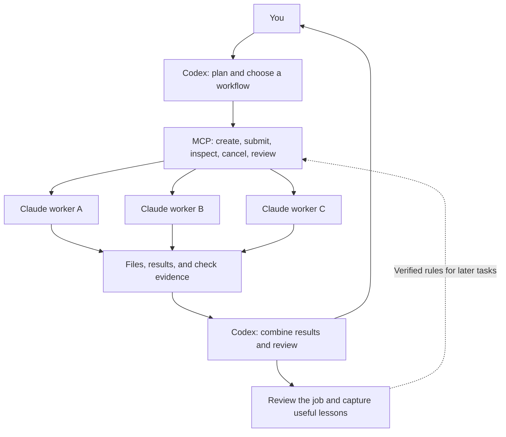

# Put Claude Code to Work for Codex

**Codex plans and reviews. Claude Code gets the work done.**

Turn the native `claude` CLI into durable workers through a lightweight MCP server. Compose **parallel research, sequential handoffs, independent judges, and mixed workflows** with the same small set of tools.

You work with Codex. Codex delegates execution, reviews the deliverables, and brings the result back to you. Other MCP-capable agents can use the server too.

## Less babysitting. Better handoffs.

- **Give the whole task once.** Define the goal, file scope, acceptance checks, and budget upfront. Let the worker implement, check, and repair within one job.
- **Keep the main conversation focused.** Submission returns a job ID immediately. Full execution logs stay on disk; the main agent reads status and results as needed.
- **Pick up where you left off.** A worker reuses its Claude Code session through `--resume`. Session and job state persist; each job starts a fresh CLI process.
- **Carry useful lessons forward.** Every finished job creates a review record. Verified worker rules can be injected into later tasks.

## One interface. Many workflows.



| Workflow | How the main agent composes it | What makes the handoff work |
| --- | --- | --- |
| Single worker | Create → submit → inspect result → review | One complete brief; implementation and self-checks in the same job |
| Parallel research | Submit independent slices to separate workers | Separate output files, cited sources, a compact synthesis |
| Sequential handoff | Worker A produces a plan; worker B implements it | Check the upstream file, then pass its actual absolute path downstream |
| Independent judges | Give the same rubric to separate workers | Independent reasons and evidence; the main agent reviews disagreements |
| Mixed workflow | Parallel research → implementation → parallel review | Explicit deliverables and acceptance checks between stages |
| Worker-owned subagents | Allow a worker to delegate part of its own task | Explicit roles, models, count, depth, and shared budget |

**These are orchestration primitives, not a built-in workflow engine.** The main agent chooses the sequence, concurrency, voting rules, and acceptance checks. The server does not include a DAG scheduler, automatic voting, or a task queue.

Each worker runs one job at a time. Different workers can run concurrently. For parallel code changes, use separate worktrees or distinct file scopes; the server does not merge conflicts for you.

### Example: parallel research

This is **main-agent pseudocode**. `call` invokes an MCP tool and parses the JSON text in its response. `waitUntilTerminal` polls `worker_status` at a sensible interval. Neither helper is provided by this repository. `root` is your actual absolute workspace path.

```js
await call("worker_create", {
  name: "research-a", cwd: root, model: "sonnet", tools: "default"
});
await call("worker_create", {
  name: "research-b", cwd: root, model: "sonnet", tools: "default"
});
const names = ["research-a", "research-b"];
const jobs = await Promise.all([
  call("worker_submit", {
    name: names[0], prompt: "Research approach A. Cite sources in research-a.md.",
    timeout: 600, max_turns: 64
  }),
  call("worker_submit", {
    name: names[1], prompt: "Independently research approach B. Cite sources in research-b.md.",
    timeout: 600, max_turns: 64
  })
]);
await Promise.all(jobs.map((job, i) => waitUntilTerminal(names[i], job.job_id)));
const results = await Promise.all(names.map((name, i) =>
  call("worker_result", {name, job_id: jobs[i].job_id})));

// After checking sources and combining the results, close each job's review.
await Promise.all(names.map(name => call("worker_review", {
  name, outcome: "none", notes: "Sources checked; no new reusable lesson."
})));
```

For a sequential handoff, wait for A's terminal result, check its output, and give B the actual absolute path, such as `/absolute/project/plan.md`. Reusing the **same** worker requires closing its previous review first. Creating or using another worker does not wait for that review.

For independent judges, give each worker a brief like:

> Independently score answer.md against rubric.md. Write judge-a.json with scores, reasons, evidence, and uncertainties. Do not read other judges' opinions. The main agent will aggregate votes, inspect disagreements, and spot-check the evidence.

To let a worker use its own Claude Code subagents, create it with `tools="default"` and explicitly authorize delegation in the initial task:

> You may use up to two subagents: one researcher and one edge-case reviewer, both using haiku, one level deep. Share this job's 600-second limit and task budget. Collect and check their outputs yourself. Return only deliverables and verification results.

Those subagents use Claude Code's own Agent/Task tools, depending on the CLI version. They are distinct from the durable workers created by this MCP. Count, model, depth, and shared-budget instructions are task-level constraints, not additional isolation enforced by this server. The default tool list is `Read,Edit,Write,Bash,Glob,Grep`; the default worker instructions prohibit subagents unless the task explicitly permits them.

## Connect in three minutes

Requirements: **macOS or Linux, Python 3.9+, and an authenticated native Claude Code CLI 2.1.259+** available to the host process. The Python server uses only the standard library. Claude usage is billed through your existing account or API arrangement.

```sh
git clone https://github.com/000ELLiu000/claude-worker-for-codex.git
cd claude-worker-for-codex
python3 workerctl.py --help
python3 -B scripts/verify_task_modes.py  # Synthetic checks; no model calls
```

Add this to Codex's `~/.codex/config.toml`, replacing the placeholder with the actual absolute path to your clone, then reconnect the MCP server in your host:

```toml
[mcp_servers.claude-worker]
command = "python3"
args = ["/absolute/path/to/claude-worker-for-codex/workerctl.py", "mcp"]

# Optional: useful when a desktop host cannot find claude on PATH.
# [mcp_servers.claude-worker.env]
# CLAUDE_WORKER_BIN = "/absolute/path/to/claude"
# CLAUDE_WORKER_STATE = "/absolute/path/to/private-worker-state"
# CLAUDE_WORKER_PERMISSION_MODE = "acceptEdits"
```

Then ask Codex:

> Use Claude workers to research two approaches in parallel, then have another worker implement the selected approach. Keep research checks lightweight, run relevant tests for the code, and handle final acceptance yourself. Bring me the deliverables and decisions that need my input.

## Tools and budgets

| MCP tool | Purpose |
| --- | --- |
| `worker_create(name, cwd, model?, tools?)` | Register a workspace and persistent session; default model: `sonnet` |
| `worker_submit(name, prompt, model?, timeout?, max_turns?)` | Submit a background job and return its ID; defaults: 600 seconds, 24 turns |
| `worker_status(name, job_id?)` | Inspect queued / running / completed / failed / cancelled / timed_out / interrupted state |
| `worker_result(name, job_id?)` | Read the final response, job metadata, and log paths |
| `worker_cancel(name, job_id?)` | Request cancellation while preserving records |
| `worker_list()` | List registered workers |
| `worker_reviews(name?)` | List pending post-job reviews |
| `worker_review(name, notes, ...)` | Close a review; optionally record a candidate or verified lesson |

Create a worker before submitting. These are the `params` objects for MCP `tools/call` requests:

```json
{"name":"worker_create","arguments":{"name":"dev","cwd":"/absolute/path/to/your-project","model":"sonnet"}}
```

```json
{"name":"worker_submit","arguments":{"name":"dev","prompt":"Fix parser.py on empty input. Run the relevant tests, repair any failures, then report changed files and actual check results.","timeout":900,"max_turns":64}}
```

Illustrative fields from the submission response; save the **actual** returned `job_id` for subsequent queries:

```json
{"job_id":"example-job-id","state":"queued","timeout_s":900,"max_turns":64}
```

The CLI shares state with the MCP server:

```sh
python3 workerctl.py create dev --cwd /absolute/path/to/your-project
python3 workerctl.py submit dev --task-file task.md --timeout 900 --max-turns 64
python3 workerctl.py wait dev --seconds 30
python3 workerctl.py result dev
# wait returns after at most 55 seconds; check again if the job is still running.
# Review only after inspecting a terminal job's deliverables.
python3 workerctl.py review dev --outcome none --notes "Deliverables checked; no new lesson."
```

Use [task-brief.md](task-brief.md) as the initial-brief template. Give self-checking enough turns; put detailed requirements in a file and pass its path to the worker.

## Clear acceptance criteria? Use native /goal.

Start the `worker_submit` prompt with the actual command; no additional hook installation is needed:

```text
/goal Complete the repair described in task.md. Relevant tests and lint pass, all changes stay within the assigned scope, and the final response lists deliverables and actual check results.
```

The controller keeps the slash command first. Goal jobs enable native session hooks; ordinary jobs disable hooks. Both isolate settings-defined hooks through `--setting-sources ""`. The goal condition plus injected rules must fit within 4,000 characters, so keep detailed instructions in a file. Timeouts and turn limits still apply.

Native `/goal` uses a separate model to evaluate completion and decide whether to continue. **Issuing the command, exiting the process, meeting the goal, and passing acceptance review are separate events.** The main agent must inspect results and appropriate evidence: light source checks for research, careful evidence sampling for judges, actual page checks for frontend work, and relevant behavioral checks for code.

References: [official CLI reference](https://code.claude.com/docs/en/cli-reference) and [official goal documentation](https://code.claude.com/docs/en/goal). The help output does not list every flag; `--max-turns` remains a supported native budget option. `--permission-prompts none` requires Claude Code 2.1.259+.

## Unattended execution and persistence

The default mode is `bypassPermissions`, equivalent to `--dangerously-skip-permissions`. Workers can read and write files and execute commands without step-by-step approvals. **The working directory is not a security sandbox.** Use a trusted, isolated workspace or environment.

Set `CLAUDE_WORKER_PERMISSION_MODE=acceptEdits` for a more restrictive mode. With `--permission-prompts none`, operations needing additional approval are denied instead of waiting for someone to answer.

The server inherits its launch environment and uses the CLI's existing authentication; it does not request GitHub or Claude credentials. Because jobs isolate user and project settings sources, environments that depend on custom authentication in those settings need separate configuration checks.

Local state defaults to `.worker-state/` beside the server. Each worker has a session manifest; each job has its input, event stream, final result, and review. Use `CLAUDE_WORKER_STATE` to choose a private state directory. Logs may contain task content and are ignored by Git by default.

Every terminal job creates a pending review. Close it before submitting another job to the same worker. Choose `outcome=none` with an explanation when there is no new lesson. Use `candidate` for unverified observations and `verified` with evidence for established lessons. Records are append-only by key; the latest verified rules with `scope=worker` are injected into later tasks.

`worker-policy.json` holds shared execution guidance. `experience.jsonl` is created when the first lesson is recorded and is ignored by Git. The Python controller handles completion callbacks and the review gate; no global Codex Stop hook is required.

## Validation and limits

- This release copy passed syntax, CLI help, synthetic job/argument checks, and MCP initialization/tool-list checks. No real paid Claude end-to-end task was run.
- Unix process management and `fcntl` are required. Windows is not supported. Flags were checked against local CLI 2.1.296 help and official documentation; other versions and hosts have not all been tested.
- There is no multi-tenant isolation, automatic retry, or queue. Submitting to a busy worker returns an error. The main agent manages dependencies, concurrency, voting, and acceptance.
- Full logs stay on disk. Results expose the final response and log paths; the main agent chooses how much to read. The server does not enforce a constant context footprint.

## License

[MIT](LICENSE) · Copyright 2026 000ELLiu000
