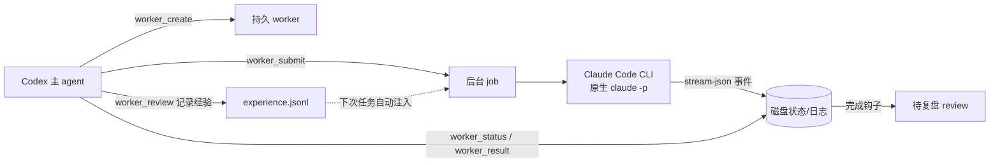

# 让 Claude Code 给 Codex 打工

**Codex 负责判断和验收，Claude Code 负责把活干完。**

Claude Worker for Codex 把原生 `claude` CLI 变成可派活、可接续会话、可查结果的 worker。**单 worker、并行分工、串行接力、独立评委投票、混合流程，都由主 agent 按任务灵活组合。**

你只对接 Codex：它负责拆任务、派活、看交付，Claude Code 在后台执行。Python 服务只用标准库；其他支持 MCP 的主 agent 也可以接入。

**English in one line:** a stdlib-only Python MCP server that turns the native `claude` CLI into durable background workers, so Codex can delegate execution to Claude Code and focus on judgment and acceptance.

## 解决什么痛点

- 两套 agent 各有所长：让擅长判断的一方当监工，擅长干活的一方当工人，而不是互相抢方向盘。
- 直接等待长任务结束，会让主对话卡在执行过程。这里每个任务都是后台 job：提交即返回 job ID，状态、结果、日志都落在磁盘上。
- 会话可复用：同一个 worker 的多次任务共享一个 Claude Code 会话（`--resume`），接续先前会话；持久的是**会话与状态文件**，不是常驻的模型进程——进程只在任务运行期间存在。



## 关键能力

- 持久 worker：一个 worker = 一个工作目录 + 一个 Claude Code 会话，崩溃后状态仍在磁盘。
- 后台 job：提交立即返回，独占运行，超时/取消可控制，完整日志（`events.jsonl`、`stderr.log`、`result.json`）留档。
- 状态/结果/取消：`worker_status` / `worker_result` / `worker_cancel`，终态为 completed / failed / cancelled / timed_out / interrupted。
- 完成后复盘：每个任务结束自动生成待复盘记录，复盘（记录经验或说明无新经验）完成前不能给同一 worker 派下一个任务；`scope=worker` 的已验证经验会在后续任务的提示词里自动注入。
- 原生 goal：prompt 以 `/goal <可验证条件>` 开头，使用原生非交互目标循环。无需额外安装 hook；命令生效、进程退出、目标达标和主 agent 验收通过是不同的事。
- 双重预算：`timeout` 控制墙钟秒数，`max_turns` 控制回合数；首次派活就给自检留够余量。

## 一套工具，灵活组合工作流

| 你要做的事 | 主 agent 如何调用 | 交接与验收 |
| --- | --- | --- |
| 单 worker 完成任务 | create → submit → status/result → review | 首次给齐目标、文件范围和验收条件，worker 在同一 job 内自检修复 |
| 多路并行调研 | 不同 worker 并行 submit | 各自写不同结果文件，汇总来源与结论 |
| 串行接力 | A 交方案，B 按方案实现 | 先检查上游文件可用，再把实际绝对路径交给 B |
| 独立评委投票 | 相同标准交给多个独立 worker | 各自交理由与证据，主 agent 汇总分歧并抽检 |
| 混合流程 | 并行调研 → 串行实现 → 并行评审 | 每阶段达到交接条件再往下走 |
| worker 自带子代理 | 开放工具，明确授权、数量和预算 | worker 收齐并核对子代理结果，再向主 agent 交付 |

**MCP 提供编排原语，流程由主 agent 决定。** 仓库没有内置 DAG 调度器、自动投票器或队列。一个 worker 同时执行一个 job；不同 worker 可以并行。并行写代码应使用独立 worktree 或明确的文件范围，MCP 不会自动合并冲突。

### 并行调用示例

这是主 agent 的**编排伪代码**：`call` 表示宿主调用 MCP 工具，`waitUntilTerminal` 表示宿主适度轮询 `worker_status`，均不是本仓库提供的函数。`root` 是实际工作目录的绝对路径。

```js
await call("worker_create", {name: "research-a", cwd: root, model: "sonnet"});
await call("worker_create", {name: "research-b", cwd: root, model: "sonnet"});
const names = ["research-a", "research-b"];
const jobs = await Promise.all([
  call("worker_submit", {name: names[0], prompt:
    "调研路线A，列出来源和结论，写入 research-a.md。", timeout: 600, max_turns: 64}),
  call("worker_submit", {name: names[1], prompt:
    "独立调研路线B，列出来源和结论，写入 research-b.md。", timeout: 600, max_turns: 64})
]);
await Promise.all(jobs.map((job, i) => waitUntilTerminal(names[i], job.job_id)));
const results = await Promise.all(names.map((name, i) =>
  call("worker_result", {name, job_id: jobs[i].job_id})));
// 主 agent 轻量核对来源、汇总 results 后，再关闭复盘。
await Promise.all(names.map(name => call("worker_review", {
  name, outcome: "none", notes: "来源已核对，本次无新增通用经验。"
})));
```

串行接力时，取得 A 的终态结果并检查输出文件后，再把 `/absolute/project/plan.md` 这样的实际绝对路径交给 B。复用同一 worker 前必须完成 `worker_review`；创建其他 worker 不需要等这份复盘。

评委提示示例：

> 独立按 rubric.md 评审 answer.md，写入 judge-a.json，包含结论、分数、证据与不确定项。不要查看其他评委意见。主 agent 将汇总投票、分歧并抽检评分依据。

需要 worker 自己拆分时，创建它时设置 `tools="default"`，首次任务明确约定：

> 允许使用最多 2 个自身子代理：一个查资料，一个检查边界；使用 haiku，最多一层，共享本任务 600 秒及预算。你负责收齐并核对结果，最后只返回交付文件与检查结论。

这是 Claude Code 自己通过当前版本 Agent/Task 等工具创建的子代理，与本 MCP 的持久 worker 是两层不同的编排。默认只开放 `Read,Edit,Write,Bash,Glob,Grep`，默认提示要求未获任务授权时不创建子代理。

接好 MCP 后，可以直接对 Codex 说：

> 用 Claude worker 并行调研两个路线，再让第三个 worker 按选定路线实现。调研轻量核对，代码跑相关测试；你负责最终验收，只给我交付和需要决定的问题。

## 3 分钟安装

需要：**macOS / Linux、Python 3.9+（仅标准库）、已登录的原生 Claude Code CLI 2.1.259+**，且 `claude` 在宿主进程的 PATH 中。Claude 的使用额度或 API 费用由你的账号承担。

```sh
git clone https://github.com/000ELLiu000/claude-worker-for-codex.git
cd claude-worker-for-codex
python3 workerctl.py --help          # 应打印子命令列表
python3 scripts/verify_task_modes.py # 合成自检，不调用任何模型
```

在 Codex 的 `~/.codex/config.toml` 中注册 MCP：

```toml
[mcp_servers.claude-worker]
command = "python3"
args = ["/absolute/path/to/claude-worker-for-codex/workerctl.py", "mcp"]

# 可选环境变量（均有默认值）：
# [mcp_servers.claude-worker.env]
# CLAUDE_WORKER_BIN = "claude"                 # claude 可执行文件，可写绝对路径
# CLAUDE_WORKER_STATE = "/absolute/path/to/private-worker-state"   # 状态目录，默认是仓库内 .worker-state
# CLAUDE_WORKER_PERMISSION_MODE = "acceptEdits" # 更保守；默认 bypassPermissions
```

## 工具一览（MCP）

| 工具 | 作用 |
| --- | --- |
| `worker_create` | 在指定目录创建持久 worker（可指定 model、tools） |
| `worker_submit` | 提交任务，立即返回 job ID；一个 worker 同时只有一个活动任务 |
| `worker_status` / `worker_result` | 查状态 / 拿最终 JSON 与日志路径 |
| `worker_cancel` | 请求取消，保留会话与日志 |
| `worker_list` | 列出已注册 worker |
| `worker_reviews` / `worker_review` | 查看 / 关闭待复盘任务，记录经验 |

## 工具调用样例

先在实际项目目录创建 worker（JSON 是 MCP `tools/call` 的 params）：

```json
{"name":"worker_create","arguments":{"name":"dev","cwd":"/absolute/path/to/your-project","model":"sonnet"}}
```

再提交任务：

```json
{"jsonrpc":"2.0","id":3,"method":"tools/call","params":{
  "name":"worker_submit",
  "arguments":{"name":"dev","prompt":"修复 parser.py 中空输入崩溃的 bug，跑通 tests/ 下相关测试后返回改动与结果。","timeout":900,"max_turns":64}}}
```

提交返回字段摘录（保存实际返回的 `job_id` 用于查询）：

```json
{"job_id":"example-job-id","state":"queued","timeout_s":900,"max_turns":64}
```

也可以直接用命令行（与 MCP 共享同一份状态）：

```sh
python3 workerctl.py create dev --cwd /absolute/path/to/your-project
python3 workerctl.py submit dev --task-file task.md --timeout 900 --max-turns 64
python3 workerctl.py wait dev --seconds 30
python3 workerctl.py result dev

# wait 最多等待55秒；仍在运行就稍后再查，终态交付经过验收后再复盘。
python3 workerctl.py review dev --notes "已核对测试输出，无新经验。"
```

## 自主执行与原生 goal

worker 在后台无人值守运行。默认 `--permission-mode bypassPermissions`，等价于 `--dangerously-skip-permissions`，可自主读写文件并执行命令，不逐步等待授权。**工作目录不是安全沙箱**，应在信任的隔离目录或环境中使用。

设置 `CLAUDE_WORKER_PERMISSION_MODE=acceptEdits` 可以收紧权限；配合 `--permission-prompts none`，其余未获授权的操作会被拒绝，不会挂起等人回答。MCP 沿用原生 CLI 的认证及启动环境，不索取 GitHub 或 Claude 凭据。任务使用 `--setting-sources ""` 隔离用户/项目 settings；依赖 settings 中自定义认证配置的环境，需要另行确认接入方式。

有明确验收标准时，把命令放在 `worker_submit` 的 prompt 首位：

```text
/goal 按 task.md 完成修复，相关测试与 lint 实际通过，只修改指定目录，最后列出交付与检查结果。
```

goal 任务启用原生会话 hook，普通任务关闭 hooks；两者都隔离 settings 定义的 hooks。goal 条件连同注入规则限制为 4000 字符，复杂细节放文件。超时和回合上限依然有效。

原生 `/goal` 使用独立模型评估并决定是否续做。**发出命令、进程退出、目标达标、验收通过，是不同的事。** 主 agent 仍需查看实际交付：探索轻量查来源，评委认真抽检，前端检查实际效果，代码运行相关行为检查。

依据：[官方 CLI reference](https://code.claude.com/docs/en/cli-reference)、[官方 goal 文档](https://code.claude.com/docs/en/goal)。帮助页未列出全部参数，`--max-turns` 仍是原生预算选项；`--permission-prompts none` 需要 2.1.259+。本副本仅做离线检查，未运行真实付费 Claude 任务。

## 持久化与复盘

- 状态目录（默认 `.worker-state/<worker>/`）：`worker.json`（会话与活动任务）、`jobs/<job>/`（任务输入、事件流、结果、复盘）。
- `experience.jsonl`：按 key 去重的经验记录，`scope=worker` 且 `status=verified` 的规则会注入后续任务提示词。首次记录经验时生成，默认不提交到 Git。
- 复盘是强制的：完成 → 待复盘 → `worker_review` 关闭（可选记录一条经验）→ 才能派下一个任务。

## 已知边界

- 仅在类 Unix（macOS / Linux）上可用（依赖 `fcntl`、`/bin/ps`）；Windows 未适配。
- 依赖原生命令行参数（`-p`、`--output-format stream-json`、`--permission-prompts`、`--permission-mode`、`--settings`、`--setting-sources`、`--tools`、`--session-id`/`--resume` 等）。参数参考本机 Claude Code CLI 2.1.296 帮助和官方文档；不同版本可能变化，未对所有宿主与版本做实测。
- 同时支持墙钟超时 `timeout` 与原生 `max_turns`；默认600秒、24轮。复杂任务可明确提高回合上限，留足自检余量。
- 原生 `/goal` 的非交互调用有官方文档依据；本副本未实际运行真实模型的 goal，仍需检查任务结果。
- 不做多租户隔离、不做队列重试：worker 忙时提交直接报错，由主 agent 决定下一步。

Python 控制器自动生成待复盘记录并执行提交门槛，无需安装 Codex 全局 Stop hook。详细任务约定见 [task-brief.md](task-brief.md)。

## License

MIT，见 [LICENSE](LICENSE)。
